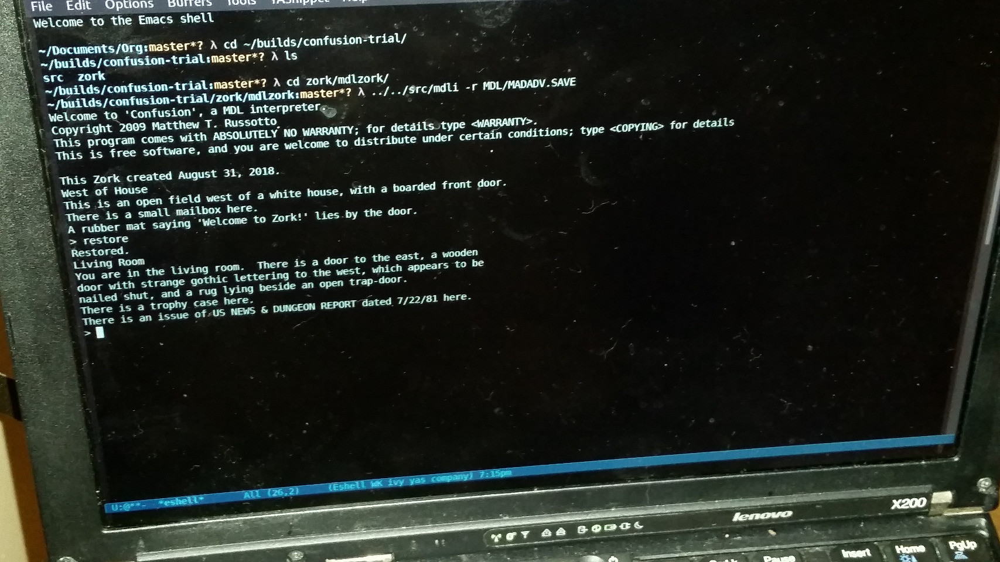

* More reimplementation of the MDL interpreter *Confusion*, plus game runners :ATTACH:
:PROPERTIES:
:ID:       d549a986-56a2-458f-bb4d-1e443b6fe587
:END:
This is *Confusion*, [[https://web.archive.org/web/20170313024629/http://www.russotto.net/git/mrussotto/confusion/src/master/src][Matthew T. Russotto's C/C++ MDL interpreter]], the purpose being to be able to run [[https://en.wikipedia.org/wiki/Infocom][Infocom]]'s old game sources written in [[https://en.wikipedia.org/wiki/MDL_(programming_language)][MDL, MIT's Model Development Language]], a weird Lisp with ~<...>~ rather than ~(...)~, with an obvious play on /muddle/ (and thus Russotto's /confusion/).

Confusion implements just enough MDL to be able to most muddle along through [[https://en.wikipedia.org/wiki/Zork#Inception][old versions of the text adventure/interactive fiction game Zork]].

This version of *Confusion* include the [[https://gitlab.com/emacsomancer/confusion-mdl][patches I made to get it running under later versions of GCC back in 2018]], [[https://github.com/heasm66/mdlzork][Henrik Åsman's later (2021-2024) patches and patched games files in MDL and Fortran]], some minor cosmetic patches I made in 2026, and "runners" for the various games (see the =zork-run-scripts= directory).

[more info to follow]

On early versions of Zork, see also [[https://en.wikipedia.org/wiki/Andrew_Plotkin][Andrew Plotkin]]'s (=Zarf's) [[https://eblong.com/infocom/#zorkmdl][The Obsessively Complete Infocom Catalog]].

Historical README notes continue below:

* Mainframe Zork for Confusion [Henrik Åsman's patched update README info]
:PROPERTIES:
:CUSTOM_ID: mainframe-zork-for-confusion
:END:
These are the currently known MDL sources of the mainframe Zork. I have
slightly changed the code to make it runnable in Matthew Russottos's
/Confusion/, the MDL emulator, “a MDL interpreter which works just well
enough to play the original Zork all the way through”. The status of the
different versions here are listed below.

** Versions 
*** 1977-12-12
This is currently the earliest version available. There is a couple of files missing, most notably the "melee"-file. This version is reconstructed with the "melee"-file from the 1978 version and some later for versions for tell.mud and prim.mud. The game is a 500 point version and fully functional and playable all the way to the end. There is no end-game so you are finished when you reached 500 points.

*** 1978-01-24
This is basically the same as the 1977 version with some parser improvements and an added end-game. The end-game is not completely finished and it is not possible to solve the last puzzle with the dungeon master to reach the finishing room and message.

*** 1979-12-11
This version is a 616 point version with a 100 points end-game that is almost identical with the 1981 version.

*** 1981-07-22
This version is almost identical to the 1979 version. There is only three small bugfixes and another issue of the US NEWS & DUNGEON REPORT. This is the source files that Bob Supnik released 2003 and the basis for many later versions of the game. The version here is with Matthew Russotto's patches to make it work under /Confusion/.

*** Dungeon 3.2b
This is not MDL, actually it's the Fortran version that Bob Supnik wrote that closely follows the 1981 version. ## Zork 285 This is not MDL. Instead it's is a ZIL-version of the very first Zork from June 14th, 1977.

*** Binaries for PDP-10 ITS
These are recovered files that works with MDL in the [[https://github.com/PDP-10/its][PDP-10 ITS emulator]].

** Playing the games
To play the games you'll need Confusion. There is a patched version in this repository that should compile with the latest gcc. The orginal can be found at [[http://www.ifarchive.org/indexes/if-archive/programming/mdl/interpreters/confusion/][IF-Archive]], Matthew Russotto's [[http://www.russotto.net/git/mrussotto/confusion][homepage]] or Benjamin Slade's [[https://gitlab.com/emacsomancer/confusion-mdl][patched version]]. Benjamin Slade also have a [[https://babbagefiles.xyz/zork-confusion/][blog post]] about compiling it. The Win32-version (by David Kinder) contains a precompiled version that works fine on these Windows versions that I tried: Windows7 (32-bit) and Windows10 (64-bit).

It is recommended that you start /Confusion/ from a terminal window (this is because the game, when finishing, will close /Confusion/ and if you are not in a terminal window the window will close and you will be unable to read the last message). You start /Confusion/ by starting =mdli.exe=

#+begin_example
./mdli.exe
#+end_example

When you have /Confusion/ running in the same directory as the source,
you type (in /Confusion/): ~~~ <FLOAD "run.mud"> ~~~ This loads all the
code, compiles, save a copy of "/MDL/MADADV.SAVE" and starts the game.
You can always start the game this way, but when you have the
"MADADV.SAVE" or another “*.SAVE”-file you can start it directly from
the prompt by (for example): ~~~ mdli -r SAVEFILE/ZORK.SAVE ~~~ or from
inside Confusion: ~~~ <RESTORE "ZORK.SAVE"> ~~~ There is only one save
slot in Zork, but you can always make your own copies in the OS. If you
find this cumbersome, remember that originaly on PDP-10 ITS the game
quit when you saved and you had to wait 24h before you could restore and
continue playing.

Thanks to Tim Anderson, Marc Blank, Bruce Daniels and Dave Lebling for
creating the original Zork and to Matthew Russotto for building
/Confusion/.

(For a modern version of Zork, I recommend Jeff Claar's C++ adaption.
This version is carefully made from the 810722 MDL source. See
https://bitbucket.org/jclaar3/zork/src/master/)

*Confusion: A MDL interpreter  [earliest README]
** (or, "How to Fit a Small Program into a Large Machine")
*** created by Matthew Russotto - (original at [[https://web.archive.org/web/20190203024317/http://www.russotto.net/git/mrussotto/confusion][http://www.russotto.net/git/mrussotto/confusion]] )

For those poor souls still stuck in dawn of IF history, I present 
"Confusion" -- a MDL interpreter which works just well enough to play 
the original Zork all the way through.  The original Zork isn't for the 
faint of heart, and neither is Confusion; it is only available in 
source form, with minimal instruction (which follows).

Confusion is written in C++, though about 99% is pure C. To build it, you 
will need the Boehm-Demers-Weiser conservative garbage collector for 
C:  <http://www.hpl.hp.com/personal/Hans_Boehm/gc/> 
Some Linux distros have this as a package, called "gc-dev" or 
similar.  For the Mac, you'll need what is at this writing the very latest
version (7.2alpha2), for Linux, 6.8 appears to work.  For Windows... I 
recommend running Linux in a virtual machine.  It might build under 
cygwin, but I wouldn't bet on it. 

Once you have the GC, a simple "make" will build the interpreter. 
The Zork sources, somewhat modified for the limitations of this 
interpreter, are available at: <http://www.russotto.net/~mrussotto/confusion/mdlzork.tgz>
[*Note:* original site seems to be offline; access an archived version instead at: <https://web.archive.org/web/20170801091842/http://www.russotto.net/~mrussotto/confusion/mdlzork.tgz> ]

[see also <https://github.com/itafroma/zork-mdl> ]

To play Zork, unpack this directory, change directory to the new 
"mdlzork" directory, run the interpreter with the parameter ~-r MDL/MADADV.SAVE~ 
e.g. ~../confusion-src/mdli -r MDL/MADADV.SAVE~. 
You should be at the white house: 

#+BEGIN_SRC 
$ ../confusion-src/mdli -r MDL/MADADV.SAVE 

This Zork created July 6, 2009. 

West of House 

This is an open field west of a white house, with a boarded front 
door. 

There is a small mailbox here. 

A rubber mat saying 'Welcome to Zork!' lies by the door. 
#+END_SRC

The HELP, DOC and INFO commands do not work, as I do not have those files. 
I have played Zork all the way through, however, I have made some 
changes to the intepreter since then, so I cannot guarantee success.  If the 
interpreter crashes, let me know.  (note that there are bugs in the 
game; if you get dumped to a MDL LISTEN prompt, this might not be an 
interpreter bug) 
If you modify the MDL sources, you can re-build the game by running 
the interpreter with no parameters in the mdlzork directory, and 
typing:

~<FLOAD "run.mud">~

[You'll almost certainly have to re-build the game as above.]

This will rebuild the MDL/MADADV.SAVE file and start the game. 

Confusion probably won't be developed further.

Notable features not supported: proper SAVE/RESTORE (an incompatible but
useful version is provided), GC-DUMP/GC-READ,  interrupts, processes, 
overflow, compiled code.

------
** Addendum

B. Slade: Minor updates to make it compile with recent versions of gcc

------
* Read more about playing the PDP-10 version of Zork here:

<https://babbagefiles.xyz/zork-confusion/>

* *NOTE: original developed on gitlab, forked from mrussotto
- old versions:
  - https://github.com/emacsomancer/confusion-mdl_pdp10-zork/tree/2018-patched
  - https://gitlab.com/emacsomancer/confusion-mdl/
- orignally forked from: https://web.archive.org/web/20170801091842/http://www.russotto.net/~mrussotto/confusion/

